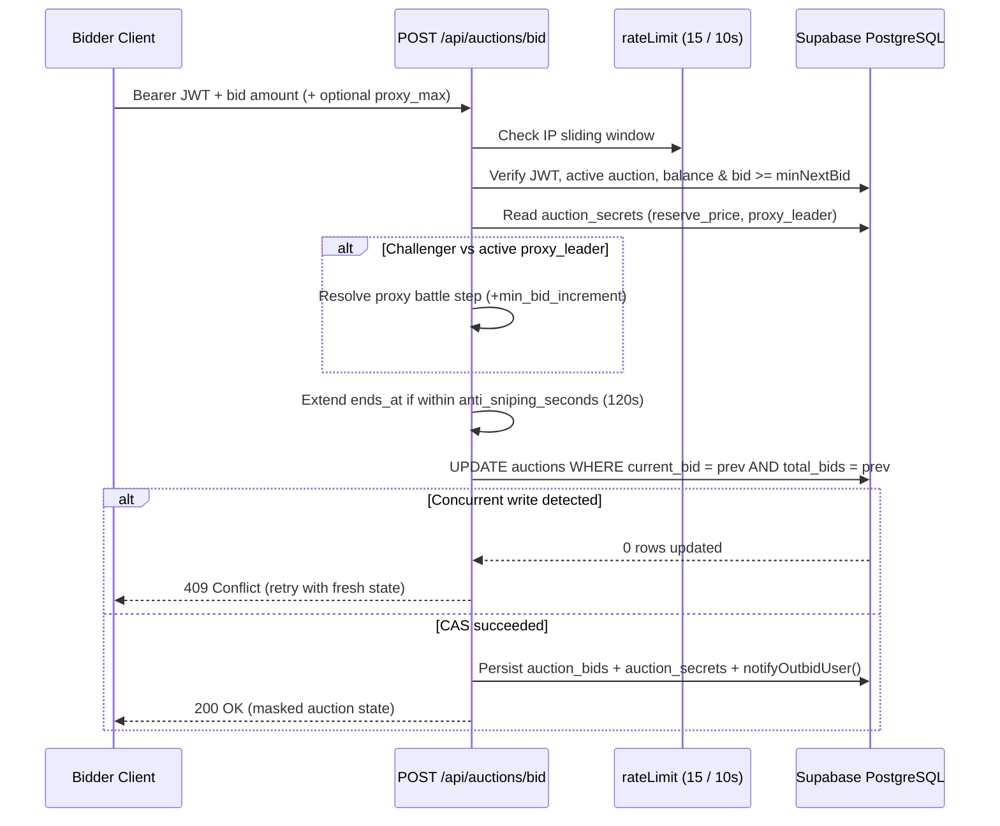

# EuropeTCG — Core Backend, Payments & PostgreSQL Security Showcase

> **Portfolio Showcase Notice:** This repository is a **curated public engineering showcase** extracted from the production codebase of **[EuropeTCG](https://europetcg.eu)** (`https://europetcg.eu`), a European C2C/B2C trading card marketplace. The full commercial platform (Next.js App Router UI, catalog ingestion pipelines, shipping rate tables, and live credentials) remains in a private repository. Every module, API route handler, and PostgreSQL migration here comes directly from the production system with sensitive identifiers redacted.

[](./tsconfig.json)
[](./tests)
[](./app/api)
[](./supabase/migrations)

---

## Engineering Highlights

### 1. Proxy Bidding, Optimistic Concurrency Control (`409`) & Anti-Sniping
Live card auctions (`app/api/auctions/bid/route.ts`) run statelessly on serverless Next.js Route Handlers without dropping race conditions:

- **Isolated Secret Storage (`auction_secrets`):** Reserve prices and maximum proxy bids (`proxy_leader.max_bid`) are stored outside the public `auctions` row and projected via `maskAuctionForClient()` (`lib/auction-helpers.ts`), so sellers never learn a bidder's secret ceiling and buyers only observe coarse reserve progress (`none` / `pending` / `close` / `met`).
- **Optimistic Concurrency Control (CAS):** Updates conditionally match `.eq('current_bid', currentBid)` and `.eq('total_bids', currentTotalBids)`. Conflicting concurrent bids return HTTP `409 Conflict` instead of overwriting a rival's bid.
- **Dynamic Anti-Sniping:** Bids accepted inside the final window (`anti_sniping_seconds`, default `120s`) extend `ends_at` atomically.



### 2. Payments, Webhooks, Idempotency & EU Compliance (AML / DAC7)
- **Stripe Webhooks & Chargeback Protection (`app/api/stripe/webhook/route.ts`):** Verifies signatures (`stripe.webhooks.constructEvent`), credits wallet deposits idempotently across synchronous/async methods (including virtual SEPA IBAN via `customer_balance`), places preventive holds + EUR 15 admin fee accounting on `charge.dispute.created`, and reconciles unapplied SEPA transfers into support tickets.
- **Database-Level Deposit Idempotency (`supabase/migrations/20261001_secure_payment_idempotency.sql`):** Partial unique index `idx_transactions_gateway_deposit_unique` prevents duplicate wallet credits even under simultaneous browser + webhook delivery.
- **Atomic Wallet RPC (`supabase/migrations/20261020_atomic_balance_adjustment.sql` + `lib/balance.ts`):** Row-level Postgres `UPDATE ... RETURNING` function locked exclusively to `service_role` and `postgres`, avoiding balance read-modify-write races.
- **AML Anti-Cashout & DAC7 Compliance (`app/api/withdraw/route.ts`):** Distinguishes unspent gateway deposits from real sales earnings (`calculateAmlWithdrawalBreakdown`), checks EU DAC7 (Directive 2021/514 / Real Decreto 117/2024) tax reporting thresholds, deducts atomically before recording SEPA payouts, and automatically rolls back balances on failure.

### 3. Marketplace Economics & Security Hardening
- **Multi-Tier Commission & Fee Cap (`lib/commission.ts`):** Differentiates Standard (`3.5%`), Pro promo (`0%` up to 50 sales), Pro Standard (`2.5%`), and manually curated Powerseller (`1.5%`), enforcing a hard **EUR 50.00 per-item fee cap**.
- **Vinted-Style Multi-Item Bundle Discounts (`lib/bundleDiscounts.ts`):** Normalizes tier percentages (bounded 0%–50%), excludes auctions and bundled lots, and calculates next-tier upsell hints.
- **PostgreSQL RLS & Privilege Hardening (`supabase/migrations/20261106_*.sql`, `20261108_*.sql`, `20261114_*.sql`):** Moves direct client mutations to server routes, enforces column-level `SELECT` restrictions on sensitive columns (`auctions.reserve_price`, `listings.private_notes`), and indexes foreign keys across financial/auth tables.
- **Application Security (`lib/security.ts`, `lib/image-allowlist.ts`, `lib/privateNotes.ts`):** Open-redirect sanitization, SSRF image hostname allowlisting, stored-XSS HTML escaping for emails, CSV formula injection neutralization (`=`, `+`, `-`, `@`), and owner-only private inventory notes.

---

## Repository Structure

```text
europetcg-core-showcase/
├── app/api/
│   ├── auctions/
│   │   ├── route.ts                 # Auction feed (masked secrets) & KYC-gated creation
│   │   └── bid/route.ts             # Proxy bidding, OCC (409), anti-sniping (+120s) & settlement
│   ├── stripe/webhook/route.ts      # Stripe signature check, SEPA cash balance & disputes
│   └── withdraw/route.ts            # AML unspent-deposit shield, DAC7 checks & SEPA payouts
├── lib/
│   ├── auction-helpers.ts           # Secret projection & proxy leader persistence
│   ├── auctionSettlement.ts         # Idempotent auction close, winner notification & order prep
│   ├── auctionEmail.ts              # Outbid transactional notifications
│   ├── balance.ts                   # Atomic RPC wrapper + fallback safeguard
│   ├── bundleDiscounts.ts           # Tiered multi-item cart discount math
│   ├── commission.ts                # Tiered fee engine with €50 per-item cap
│   ├── grading.ts                   # PSA/BGS/CGC/SGC/ACE certification & subgrades parser
│   ├── image-allowlist.ts           # SSRF domain allowlist + image proxy builder
│   ├── mailer.ts                    # Multi-provider email dispatcher (Brevo API / SMTP / fallback)
│   ├── privateNotes.ts              # Owner-only private inventory note isolation
│   ├── rate-limit.ts                # Sliding-window IP rate limiter
│   ├── security.ts                  # Redirect validation, CSV/HTML escaping & private attachment resolution
│   ├── stripeDeposit.ts             # SEPA virtual IBAN & idempotent wallet credit workflow
│   └── supabase-admin.ts            # Service-role Supabase client
├── supabase/migrations/
│   ├── 20260918_add_auctions_system.sql
│   ├── 20261001_secure_payment_idempotency.sql
│   ├── 20261020_atomic_balance_adjustment.sql
│   ├── 20261106_blindaje_seguridad_rls.sql
│   ├── 20261108_close_orders_and_auctions_rls.sql
│   └── 20261114_fix_profile_fks_and_indexes.sql
└── tests/                           # Deterministic Vitest unit suite (mock-isolated from live DB/APIs)
```

---

## Verification

All unit tests run offline against pure domain helpers, security sanitizers, and mocked DB boundaries — no external API keys required:

```bash
npm install
npm run typecheck   # Strict TypeScript check across API routes, libs, and tests
npm test            # Vitest suite (17 unit tests across 6 test files)
```
